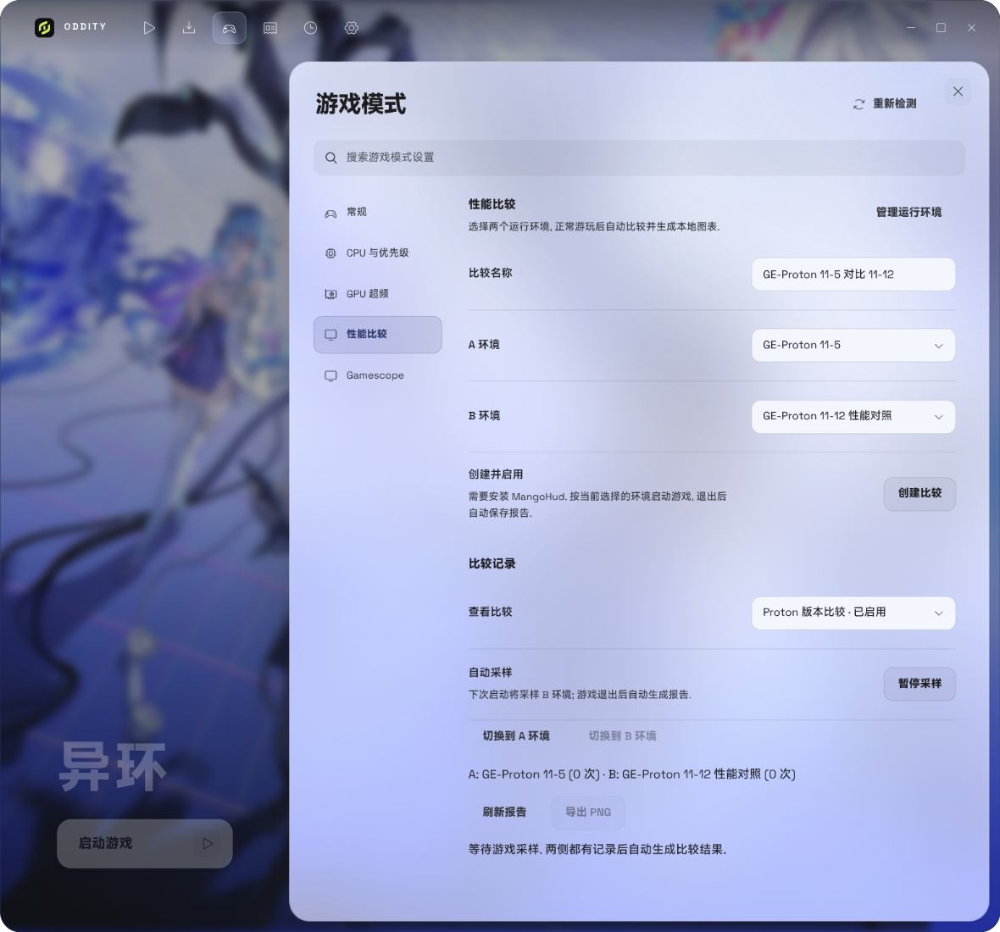
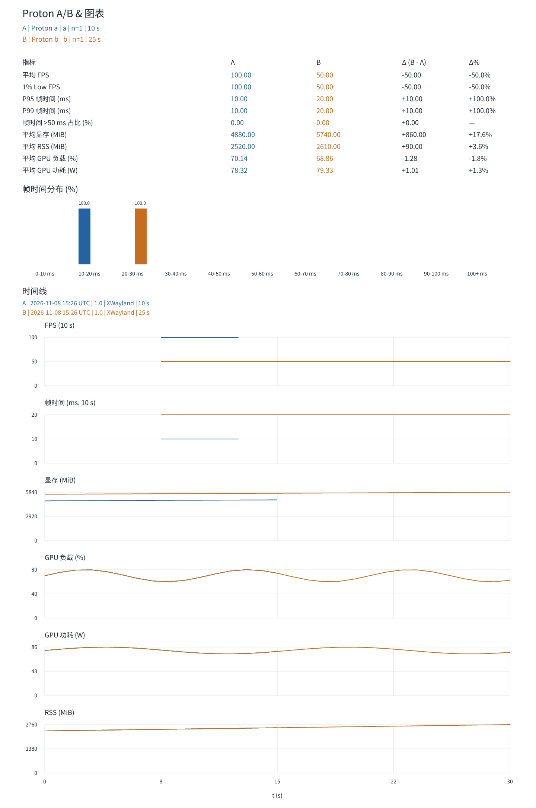

# Proton A/B 性能比较

在 **游戏模式 → 性能比较** 中选择两个 Proton 运行环境并创建比较. A 默认选择稳定环境, B 选择另一环境. 环境必须属于同一游戏、地区和安装目录. 未创建环境时, 点击 **管理运行环境** 前往设置.

## 采样与报告

1. 安装系统 MangoHud.
2. 输入比较名称, 选择 A/B 并点击 **创建比较**.
3. 点击 **切换到 A 环境**, 正常启动和游玩, 退出游戏后自动生成本地报告.
4. 切换到 B 环境并游玩. 退出后自动计算 A/B 差值并生成图表.
5. 后续启动 A 或 B 会继续加入该比较. 可以暂停采样, 或启用另一份比较. 其他环境不会加入采样.

应用内自动展示指标对比、帧时间分布和最近一次 A/B 会话时间线. 每次会话的统计和采样配置单独保留. 点击 **导出 PNG** 保存可分享的图表. 报告不会自动更改稳定环境.

采样不要求固定路线或内置基准测试. 场景由玩家控制; 不同会话的同一经过时间不代表同一场景. 游戏版本、显示模式和启动配置差异会记录在报告中.

## 统计口径

- 使用 MangoHud `log_interval=0` 的逐帧日志, 排除日志前 5 秒初始化数据. 此后保留加载、菜单和实际游玩中的全部有效帧.
- 平均 FPS = 总帧数 / 总帧时间.
- 1% Low = 最慢 1% 帧时间均值的倒数, 数量向上取整.
- P95/P99 为帧时间的最近秩分位数.
- 长帧时间占比 = 超过 50 ms 的帧时间总和 / 总帧时间.
- 多次会话的指标按会话等权汇总. 分布按各会话的帧数百分比等权汇总.
- 时间线 FPS 按 10 秒窗口聚合. 硬件指标约每秒采样, 与帧日志近似对齐.

游戏常驻内存和系统可用内存来自 `/proc`. NVIDIA GPU 指标通过 `nvidia-smi -q -x` 中的 G / C+G 进程匹配游戏 PID, 再按 GPU UUID 获取; 无法获得的指标显示缺失, 不填零. 首版未接入 AMD/Intel GPU 硬件指标, 不影响逐帧比较. 显存和负载是所选 GPU 的总量, 不是游戏独占用量.

## 本地文件

记录位于 `~/.local/share/oddity/performance/`, 设置了 `XDG_DATA_HOME` 时路径随之调整:

- `index.json`: 比较与会话数据. 界面 overview 只返回统计和元数据, 不传输采样点或直方图.
- `<比较 ID>/report.json`, `report.svg`, `report.png`: 自动更新的完整报告及图表.
- `<比较 ID>/<会话 ID>/`: 原始逐帧 CSV、硬件 JSONL、采样元数据和单次统计.

采样仅向本轮游戏启动链传入 MangoHud 日志参数, 保留既有配置, 不修改全局配置文件, 不上传数据. 原始逐帧日志保留在本地, 文件大小随游玩时长增加.

日志缺失、多个日志或有效采样不足会显示具体原因. 若手动使用 MangoHud 热键切换日志产生分段, 请重新完成一次连续采样.

## 图表样例

以下使用模拟数据展示报告格式.

