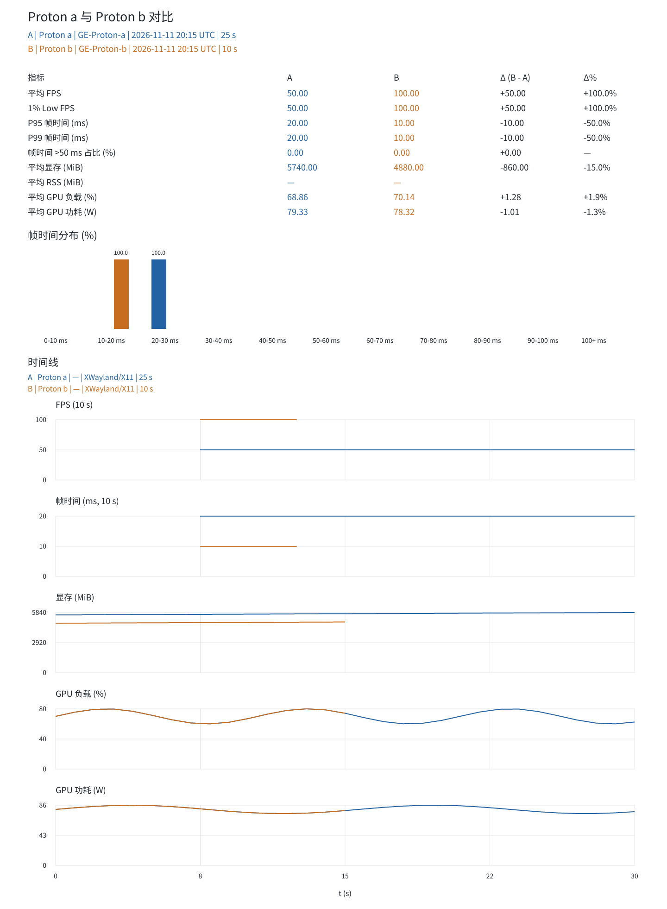

# 性能记录

开启性能记录后, 每次启动游戏都会自动保存一条记录. 记录包含环境名称、Proton 版本、帧时间统计和硬件指标, 之后可以在 **游戏模式 → 性能记录** 中挑选任意两条对比.

记录开关默认关闭, 在性能记录页打开. 开关保存在性能记录自己的数据里, 切换游戏或环境不会重置. 环境被改名或删除后, 历史记录仍显示采样时的环境名称和 Proton 版本.

## 采样

1. 安装系统 MangoHud.
2. 打开性能记录开关, 在运行环境设置里选好要测试的 Proton 环境.
3. 正常启动和游玩, 退出游戏后自动保存本次记录.
4. 换一个环境或配置重复启动, 再次得到一条记录.
5. 在记录列表中选两条: 默认把较早的一条作为 A (基准), 较晚的一条作为 B (对比), 差值为 B - A.

未安装 MangoHud、日志缺失或日志无法解析时, 本次采样会直接丢弃, 不写入记录, 也不打断游戏.

关闭开关只影响之后的启动, 正在进行的采样仍会完成并生成记录.

应用内展示指标差值、帧时间分布和两条记录的时间线. 点击 **导出 PNG** 保存可分享的图表. 记录不会更改当前环境.

采样不要求固定路线或内置基准测试. 场景由玩家控制; 不同记录的同一经过时间不代表同一场景. 游戏版本与显示后端标注在图表的时间线图例里, 采样配置保存在每条记录的原始数据中.

## 保留策略

每个游戏保留最近 10 条未固定的记录, 更早的记录连同原始文件一起删除. 固定 (pin) 的记录不受限制, 一直保留, 可以随时取消固定; 取消固定不会立刻删除记录, 超出上限的记录会在下一次采样完成后淘汰. 从旧版本升级来的记录默认固定. 记录也可以手动删除, 删除后连同原始文件一起移除.

## 统计口径

- 使用 MangoHud `log_interval=0` 的逐帧日志, 排除日志前 5 秒初始化数据. 此后保留加载、菜单和实际游玩中的全部有效帧.
- 平均 FPS = 总帧数 / 总帧时间.
- 1% Low = 最慢 1% 帧时间均值的倒数, 数量向上取整.
- P95/P99 为帧时间的最近秩分位数.
- 长帧时间占比 = 超过 50 ms 的帧时间总和 / 总帧时间.
- 时间线 FPS 按 10 秒窗口聚合. 硬件指标约每秒采样, 与帧日志近似对齐.

游戏内存和系统可用内存来自 `/proc`. NVIDIA GPU 指标通过 `nvidia-smi -q -x` 中的 G / C+G 进程匹配游戏 PID, 再按 GPU UUID 获取; 无法获得的指标显示缺失, 不填零. 未接入 AMD/Intel GPU 硬件指标, 不影响逐帧比较. 显存和负载是所选 GPU 的总量, 不是游戏独占用量.

## 本地文件

记录位于 `~/.local/share/oddity/performance/`, 设置了 `XDG_DATA_HOME` 时路径随之调整:

- `index.json`: 采样开关和记录列表. 界面 overview 只读取统计和元数据, 不传输采样点或直方图.
- `records/<记录 ID>/`: 原始逐帧 CSV、硬件 JSONL、采样元数据, 以及 `samples.json` 里的采样点和帧时间分布. 采样进行中的目录带 `.recording` 标记, 采样前的清理靠它跳过.

报告在打开或导出时按当前选中的两条记录即时生成, 不落盘保存. 采样仅向本轮游戏启动链传入 MangoHud 日志参数, 保留既有配置, 不修改全局配置文件, 不上传数据. 原始逐帧日志保留在本地, 文件大小随游玩时长增加.

日志缺失或有效采样不足的记录会被丢弃. 若手动使用 MangoHud 热键切换日志产生分段, 请重新完成一次连续采样.

## 图表样例

以下使用模拟数据展示报告格式.

